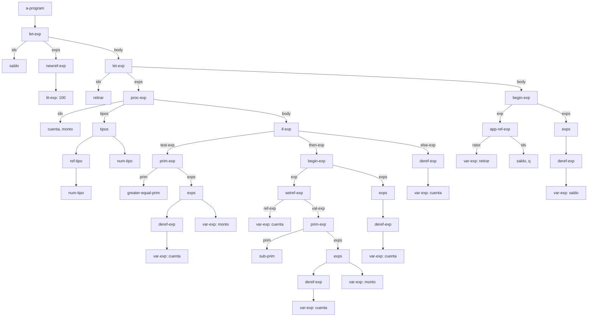
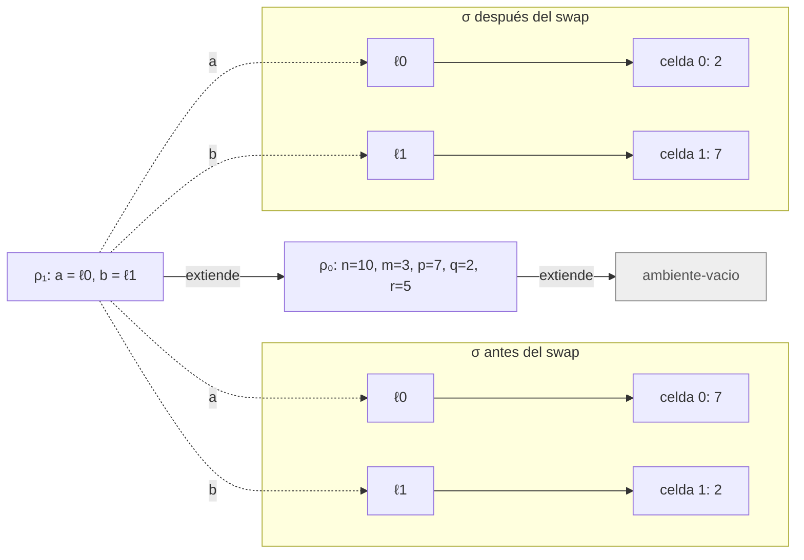

# Informe de AST — Taller 3: Memoria y disciplina

**Curso:** Fundamentos de Interpretación y Compilación de Lenguajes
de Programación — Universidad del Valle, Sede Tuluá.

**Integrantes del grupo:**

| Nombre | Código | Correo institucional |
|--------|--------|----------------------|
| Adriana Milena Noscue Dagua | 2477336 | adriana.noscue@correounivalle.edu.co |
| Sebastian Cucalon Astorquiza | 2477344 | sebastian.cucalon@correounivalle.edu.co |
| Santiago Torres Rojas | 2380301 | santiago.torres.rojas@correounivalle.edu.co |
| Nicolle Camila Hoyos Puin | 2380608 | nicolle.hoyos@correounivalle.edu.co |

---

## 1. Gramática considerada

Esta es la gramática de `src/sintaxis.rkt`. Los nombres bajo cada producción son los constructores que aparecen como etiquetas en los diagramas.

```bnf
<programa>   ::= <expresion>
                  a-program(exp)

<expresion>  ::= <numero>
                  lit-exp(datum)
             ::= "true"
                  true-exp()
             ::= "false"
                  false-exp()
             ::= <identificador>
                  var-exp(id)
             ::= <primitiva> "(" {<expresion>}*(,) ")"
                  prim-exp(prim, exps)
             ::= "if" <expresion> "then" <expresion> "else" <expresion> "end"
                  if-exp(test-exp, then-exp, else-exp)
             ::= "let" {<identificador> "=" <expresion>}* "in" <expresion> "end"
                  let-exp(ids, exps, body)
             ::= "case" <expresion> "of" {<numero> "=>" <expresion>}* "else" <expresion> "end"
                  case-exp(car-exp, val-nums, body-exps, else-exp)
             ::= "proc" "(" {<identificador> ":" <tipo>}*(,) ")" <expresion> "end"
                  proc-exp(ids, tipos, body)
             ::= "apply" <expresion> "(" {<expresion>}*(,) ")"
                  app-exp(rator, rands)
             ::= "applyref" <expresion> "(" {<identificador>}*(,) ")"
                  app-ref-exp(rator, ids)
             ::= "letrec" {<tipo> <identificador> "(" {<identificador> ":" <tipo>}*(,) ")" "=" <expresion>}*
                 "in" <expresion> "end"
                  letrec-exp(tipos-res, proc-names, idss, tipos-args, bodies, body)
             ::= "newref" "(" <expresion> ")"
                  newref-exp(exp)
             ::= "deref" "(" <expresion> ")"
                  deref-exp(exp)
             ::= "setref" "(" <expresion> "," <expresion> ")"
                  setref-exp(ref-exp, val-exp)
             ::= "swap" "(" <expresion> "," <expresion> ")"
                  swap-exp(ref1-exp, ref2-exp)
             ::= "begin" <expresion> {";" <expresion>}* "end"
                  begin-exp(exp, exps)

<tipo>       ::= "num"
                  num-tipo()
             ::= "bool"
                  bool-tipo()
             ::= "refto" "(" <tipo> ")"
                  ref-tipo(t)
             ::= "(" {<tipo>}*(*) "->" <tipo> ")"
                  proc-tipo(args, res)

<primitiva>  ::= "+"    sum-prim        ::= "-"   sub-prim
             ::= "*"    mult-prim       ::= "add1" add1-prim
             ::= "sub1" sub1-prim       ::= "=="  equal-prim
             ::= ">"    greater-prim    ::= ">="  greater-equal-prim
             ::= "<"    less-prim       ::= "<="  less-equal-prim
             ::= "and"  and-prim        ::= "or"  or-prim
             ::= "not"  not-prim
```

Realización de los no terminales con `define-datatype` (generados por SLLGEN):

| No terminal | Variantes del datatype | Campos |
|---|---|---|
| `<programa>` | `a-program` | `exp` (expresión) |
| `<expresion>` | `lit-exp`, `true-exp`, `false-exp`, `var-exp`, `prim-exp`, `if-exp`, `let-exp`, `case-exp`, `proc-exp`, `app-exp`, `app-ref-exp`, `letrec-exp`, `newref-exp`, `deref-exp`, `setref-exp`, `swap-exp`, `begin-exp` | los de la gramática anterior |
| `<tipo>` | `num-tipo`, `bool-tipo`, `ref-tipo`, `proc-tipo` | (ninguno); (ninguno); `t` (tipo); `args` (lista de tipos), `res` (tipo) |
| `<primitiva>` | `sum-prim`, `sub-prim`, `mult-prim`, `add1-prim`, `sub1-prim`, `equal-prim`, `greater-prim`, `greater-equal-prim`, `less-prim`, `less-equal-prim`, `and-prim`, `or-prim`, `not-prim` | (ninguno) |

---

## 2. Ejemplos de AST

### Ejemplo 1 — retiro de una cuenta con paso por referencia (4.1)

**Expresión concreta:**

```scheme
let saldo = newref(100)
in
  let retirar = proc (cuenta : refto(num), monto : num)
                  if >=(deref(cuenta), monto)
                  then begin
                         setref(cuenta, -(deref(cuenta), monto));
                         deref(cuenta)
                       end
                  else deref(cuenta)
                  end
                end
  in
    begin
      applyref retirar (saldo, q);
      deref(saldo)
    end
  end
end
```

**Construcción:**

```scheme
(a-program
 (let-exp '(saldo)
          (list (newref-exp (lit-exp 100)))
          (let-exp '(retirar)
                   (list
                    (proc-exp '(cuenta monto)
                              (list (ref-tipo (num-tipo)) (num-tipo))
                              (if-exp
                               (prim-exp (greater-equal-prim)
                                         (list (deref-exp (var-exp 'cuenta))
                                               (var-exp 'monto)))
                               (begin-exp
                                (setref-exp (var-exp 'cuenta)
                                            (prim-exp (sub-prim)
                                                      (list (deref-exp (var-exp 'cuenta))
                                                            (var-exp 'monto))))
                                (list (deref-exp (var-exp 'cuenta))))
                               (deref-exp (var-exp 'cuenta)))))
                   (begin-exp
                    (app-ref-exp (var-exp 'retirar) '(saldo q))
                    (list (deref-exp (var-exp 'saldo)))))))
```

**AST:**



**Explicación:** La raíz es `a-program`, y el cuerpo es un `let-exp` anidado en otro. Los nodos de tipo (`ref-tipo` con su `num-tipo`, y `num-tipo`) cuelgan del nodo `tipos` de `proc-exp`, en el mismo orden que los parámetros `cuenta` y `monto`. Cada `prim-exp` lleva su primitiva (`greater-equal-prim`, `sub-prim`) y la lista de operandos. En `begin-exp`, el campo `exp` guarda la primera expresión y `exps` la lista de las restantes. En `app-ref-exp` los argumentos son identificadores (`saldo`, `q`) y no expresiones, porque `applyref` solo acepta variables ligadas a referencias.

### Al correr el programa en el chequeador, este lo rechaza con el mensaje `El argumento 2 debe ser refto(t), se encontro num`.

La regla de `applyref` exige, para cada argumento $x_i$, que $\Gamma(x_i) = t_i$ y que $t_i = \texttt{refto}(s_i)$. El procedimiento `retirar` tiene tipo $(\texttt{refto(num)} * \texttt{num} \to \texttt{num})$ y el segundo argumento incumple la regla por dos motivos:

- `q` viene del ambiente inicial, donde $\Gamma(q) = \texttt{num}$, así que no es una referencia.
- El parámetro `monto` está declarado como $\texttt{num}$, y un parámetro de ese tipo no puede ligarse por referencia.

El primer argumento sí cumple, porque $\Gamma(\texttt{saldo}) = \texttt{refto(num)}$.

### Corrección mínima

Hay que declarar `monto` como `refto(num)`, leerlo con `deref` y pasar un identificador ligado a una referencia en lugar de `q`:

```scheme
let saldo = newref(100)
in
  let retirar = proc (cuenta : refto(num), monto : refto(num))
                  if >=(deref(cuenta), deref(monto))
                  then begin
                         setref(cuenta, -(deref(cuenta), deref(monto)));
                         deref(cuenta)
                       end
                  else deref(cuenta)
                  end
                end
  in
    let monto_ref = newref(q)
    in
      begin
        applyref retirar (saldo, monto_ref);
        deref(saldo)
      end
    end
  end
end
```

Ahora $\Gamma(\texttt{saldo}) = \texttt{refto(num)}$ y $\Gamma(\texttt{monto\_ref}) = \texttt{refto(num)}$ coinciden con los tipos de los parámetros. Las dos ramas del `if` tienen tipo $\texttt{num}$, y el programa tiene tipo $\texttt{num}$. Al ejecutarlo, `retirar` escribe $98$ en la celda de `saldo`, y el resultado es $98$.

---

## 3. Traza de evaluación

### Traza con el estado del almacén (4.2)

**Expresión a evaluar** (segundo ejemplo guía de la Parte 1):

```scheme
let a = newref(7)
    b = newref(2)
in
  begin
    swap(a, b);
    +(deref(a), *(10, deref(b)))
  end
end
```

**Ambiente inicial:** $\rho_0 = [\,n = 10,\ m = 3,\ p = 7,\ q = 2,\ r = 5\,]$. El ambiente del cuerpo del `let` es $\rho_1 = [\,a = \ell_0,\ b = \ell_1\,]\,\rho_0$, donde $\ell_i$ es la referencia a la posición $i$ del almacén. El almacén empieza vacío: $\sigma = [\,]$.

**Pasos de la traza:**

| Expresión evaluada | Ambiente | Estado del almacén | Valor resultante |
|---|---|---|---|
| `newref(7)` | $\rho_0$ | $\sigma = [\,] \to [\,0 \mapsto 7\,]$ | $\ell_0$ |
| `newref(2)` | $\rho_0$ | $\sigma = [\,0 \mapsto 7\,] \to [\,0 \mapsto 7,\ 1 \mapsto 2\,]$ | $\ell_1$ |
| cuerpo del `let`: `begin swap(a, b); ... end` | $\rho_1$ | $\sigma = [\,0 \mapsto 7,\ 1 \mapsto 2\,]$ | (ver filas siguientes) |
| `swap(a, b)` | $\rho_1$ | $\sigma = [\,0 \mapsto 7,\ 1 \mapsto 2\,] \to [\,0 \mapsto 2,\ 1 \mapsto 7\,]$ | $2$ |
| `deref(a)` | $\rho_1$ | $\sigma = [\,0 \mapsto 2,\ 1 \mapsto 7\,]$ | $2$ |
| `deref(b)` | $\rho_1$ | $\sigma = [\,0 \mapsto 2,\ 1 \mapsto 7\,]$ | $7$ |
| `*(10, deref(b))` | $\rho_1$ | $\sigma = [\,0 \mapsto 2,\ 1 \mapsto 7\,]$ | $70$ |
| `+(deref(a), *(10, deref(b)))` | $\rho_1$ | $\sigma = [\,0 \mapsto 2,\ 1 \mapsto 7\,]$ | $72$ |
| `begin ... end` y `let` completo | $\rho_0$ | $\sigma = [\,0 \mapsto 2,\ 1 \mapsto 7\,]$ | $72$ |

Las dos `newref` se evalúan en $\rho_0$, porque `let` evalúa sus ligaduras antes de extender el ambiente. El `swap` retorna $2$, que es el contenido anterior de la segunda celda.

**Diagrama de la cadena de ambientes y del almacén:**



**Explicación:** La cadena de ambientes tiene dos marcos y termina en `ambiente-vacio`: $\rho_1$ extiende a $\rho_0$, y $\rho_0$ extiende al ambiente vacío. Las referencias que guardan `a` y `b` son las mismas antes y después del `swap`. Lo que cambia es el contenido de las celdas, que quedan intercambiadas.

---

## 4. Estado del almacén en una transacción

**No aplica.** El enunciado del Taller 3 no incluye bloques transaccionales (`atomic`) ni reversión de escrituras. El estado del almacén se muestra en la sección 3, con las dos instantáneas antes y después del `swap`.

---

## 5. Referencias

- Friedman, D. P., & Wand, M. *Essentials of Programming Languages*,
  3.ª ed., MIT Press, 2008. Sección 2.2 (ambientes), sección 2.4
  (`define-datatype` y `cases`), capítulo 4 (sección 4.2 EXPLICIT-REFS
  y sección 4.3 paso por referencia) y capítulo 7 (secciones 7.1 a 7.3).
- Documentación oficial del lenguaje Racket (`#lang eopl`): https://docs.racket-lang.org/eopl/
````
