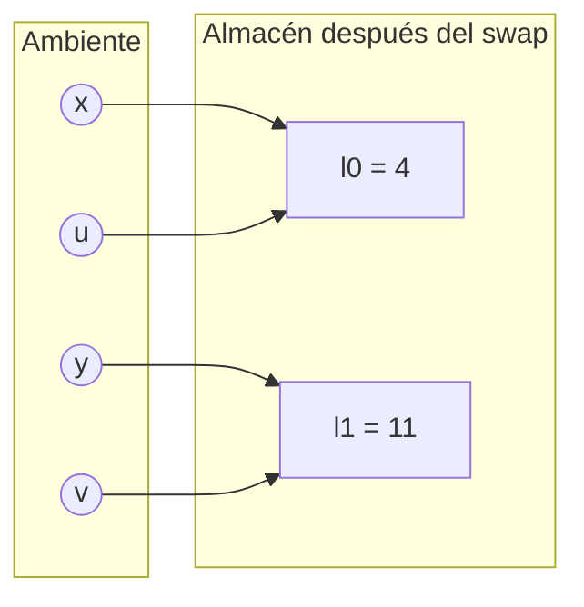
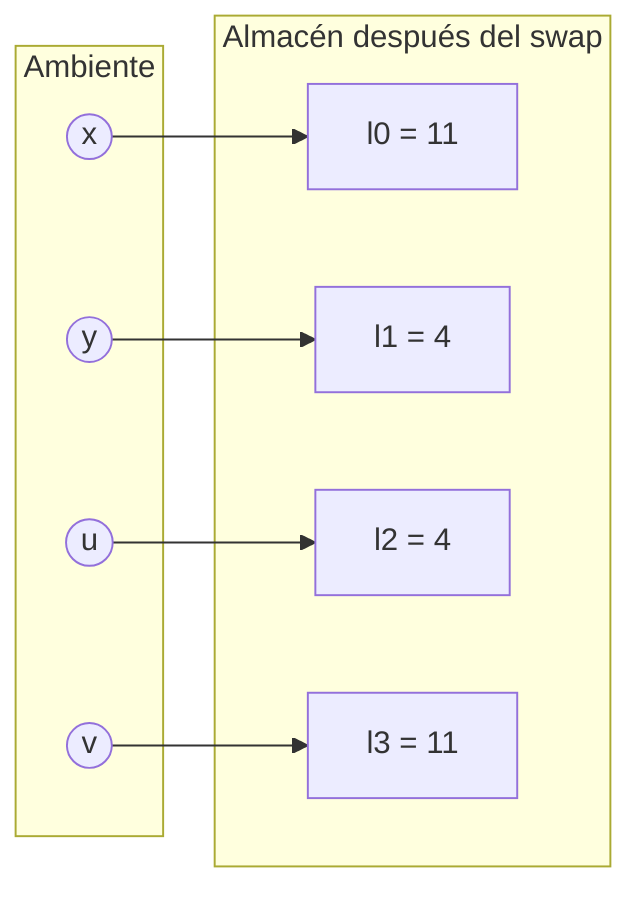
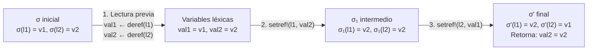
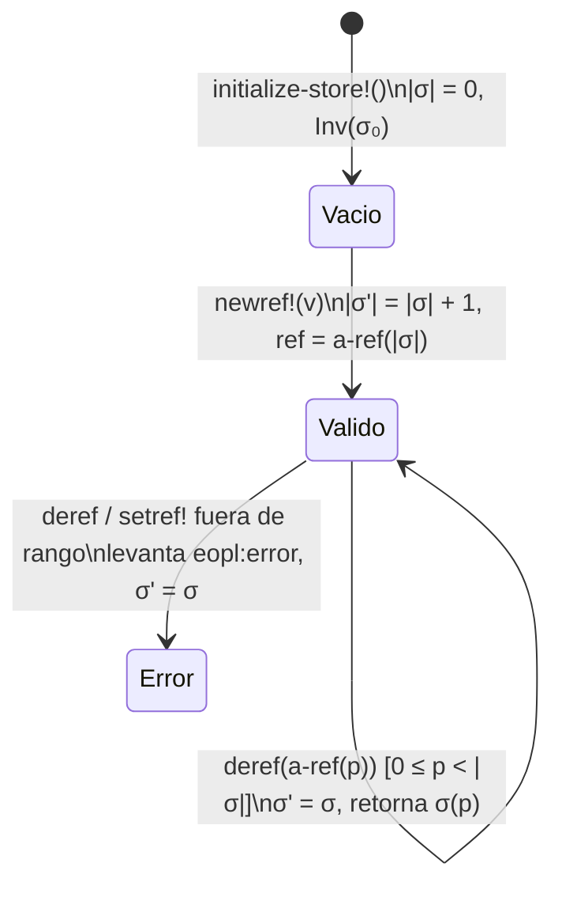
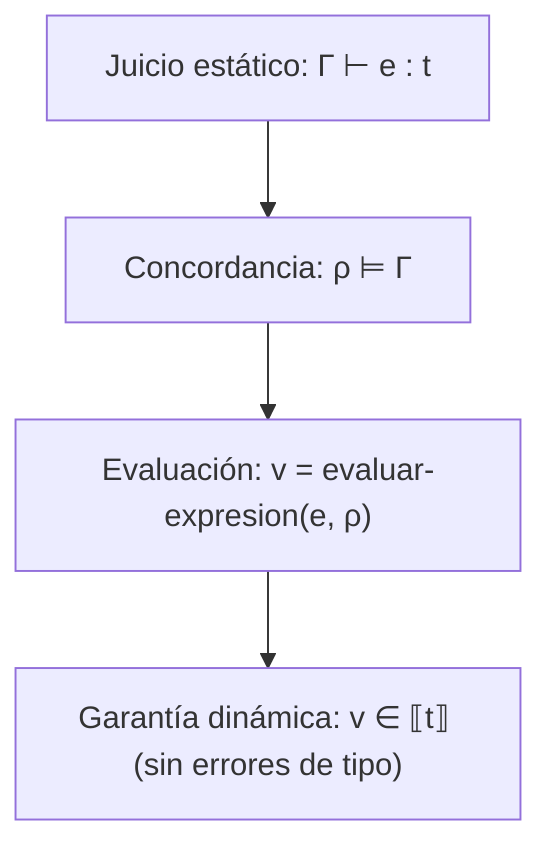

# Informe de corrección — Taller 3

**Curso:** Fundamentos de Interpretación y Compilación de Lenguajes
de Programación — Universidad del Valle, Sede Tuluá.

**Integrantes del grupo:**

| Nombre completo | Código | Correo institucional |
|---|---|---|
| Adriana Milena Noscue Dagua | 2477336 | adriana.noscue@correounivalle.edu.co |
| Sebastian Cucalon Astorquiza | 2477344 | sebastian.cucalon@correounivalle.edu.co |
| Santiago Torres Rojas | 2380301 | santiago.torres.rojas@correounivalle.edu.co |
| Nicolle Camila Hoyos Puin | 2380608 | nicolle.hoyos@correounivalle.edu.co |	

---

Informe 


## Parte 2: paso por valor y paso por referencia

### 1. Los dos mecanismos

En Cauca con referencias, una referencia $\ell$ es un valor de primera clase: se puede ligar a un identificador, guardar en una celda y pasar a un procedimiento. Por eso la diferencia entre `apply` y `applyref` no está en *qué* se pasa, sino en *qué se hace con lo que se pasa*.

- **`apply` (por valor).** Evalúa cada argumento y liga el parámetro a una **copia** del valor resultante.
- **`applyref` (por referencia).** Sus argumentos son identificadores ya ligados a referencias, y cada parámetro queda ligado a **la misma referencia**, sin copiar nada.

La función de copia que usa `apply` (`copia-por-valor` en `src/interprete.rkt`) se define así:

$$
\mathrm{copia}(v) =
\begin{cases}
v & \text{si } v \text{ no es una referencia (número, booleano, procedimiento)} \\
\mathrm{newref!}(\mathrm{deref}(\ell)) & \text{si } v = \ell \text{ es una referencia}
\end{cases}
$$

Para un número, un booleano o un procedimiento, la copia es el mismo valor y no hay nada observable. Para una referencia, copiar es reservar una celda nueva con el mismo contenido: el procedimiento recibe **su propia celda** y lo que escriba adentro no se ve afuera. Esa regla es la que separa los dos mecanismos. Sin ella serían indistinguibles, porque pasar una referencia por valor compartiría la celda igual.

**`let` no copia.** La ligadura `let otro = celda` liga `otro` a la misma referencia que `celda`, de modo que los dos nombres son alias de una sola celda. La diferencia entre ligar con `let` y pasar con `apply` es deliberada: `let` comparte la celda, `apply` entrega una copia.

### 2. Semántica de `app-ref-exp`

1. Evalúa el operador y verifica con `procval?` que sea un procedimiento; si no, levanta `eopl:error`.
2. Busca cada identificador en el ambiente y verifica con `referencia?` que su valor sea una referencia; si alguno no lo es, levanta `eopl:error` indicando que el paso por referencia exige variables ligadas a referencias.
3. Verifica que la cantidad de argumentos coincida con la de parámetros; si no, levanta `eopl:error`.
4. Evalúa el cuerpo en el ambiente de la clausura extendido con los parámetros ligados a **esas mismas referencias** (sin pasar por `copia-por-valor`).

### 3. El programa que separa los dos mecanismos

```
let x = newref(11)
    y = newref(4)
in
  let intercambiar = proc (u : refto(num), v : refto(num))
                       swap(u, v)
                     end
  in
    begin
      applyref intercambiar (x, y);
      -(deref(x), deref(y))
    end
  end
end
```

**Resultado: $-7$.**

Tras `newref(11)` y `newref(4)`, el almacén es

$$\sigma_0 = [\,0 \mapsto 11,\ 1 \mapsto 4\,]$$

con `x` ligada a $\ell_0$ y `y` ligada a $\ell_1$. Con `applyref`, `u` queda ligada a $\ell_0$ y `v` a $\ell_1$: son las mismas celdas. El `swap(u, v)` intercambia sus contenidos:

$$\sigma_1 = [\,0 \mapsto 4,\ 1 \mapsto 11\,]$$

Al volver, `deref(x)` $= 4$ y `deref(y)` $= 11$, así que `-(deref(x), deref(y))` $= 4 - 11 = -7$.



#### La misma expresión con `apply`

```
let x = newref(11)
    y = newref(4)
in
  let intercambiar = proc (u : refto(num), v : refto(num))
                       swap(u, v)
                     end
  in
    begin
      apply intercambiar (x, y);
      -(deref(x), deref(y))
    end
  end
end
```

**Resultado: $7$.**

Con `apply`, antes de entrar al cuerpo se copian los argumentos: `copia-por-valor` reserva $\ell_2$ con el contenido de $\ell_0$ y $\ell_3$ con el de $\ell_1$:

$$\sigma_1 = [\,0 \mapsto 11,\ 1 \mapsto 4,\ 2 \mapsto 11,\ 3 \mapsto 4\,]$$

`u` queda ligada a $\ell_2$ y `v` a $\ell_3$. El `swap(u, v)` actúa solo sobre las copias:

$$\sigma_2 = [\,0 \mapsto 11,\ 1 \mapsto 4,\ 2 \mapsto 4,\ 3 \mapsto 11\,]$$

Las celdas de `x` y `y` ($\ell_0$ y $\ell_1$) no cambiaron, así que `-(deref(x), deref(y))` $= 11 - 4 = 7$.



| Mecanismo | Celdas que ve `u`, `v` | `deref(x)` | `deref(y)` | Resultado |
|---|---|---|---|---|
| `applyref` | $\ell_0$, $\ell_1$ (las mismas) | 4 | 11 | $-7$ |
| `apply` | $\ell_2$, $\ell_3$ (copias) | 11 | 4 | $7$ |

### 4. Ejemplos adicionales de paso por referencia

**Ejemplo A: un contador que se incrementa desde un procedimiento.**

```
let c = newref(0)
    inc = proc (r : refto(num)) setref(r, add1(deref(r))) end
in begin applyref inc (c); applyref inc (c); deref(c) end end
```

Resultado: $2$. Cada `applyref` escribe en la celda de `c`. Con `apply` en lugar de `applyref` el resultado es $0$, porque `inc` incrementa una copia y la celda de `c` no cambia.

**Ejemplo B: dos celdas, una se modifica con el contenido de la otra.**

```
let a = newref(3)
    b = newref(4)
    sumar = proc (x : refto(num), y : refto(num))
              setref(x, +(deref(x), deref(y)))
            end
in begin applyref sumar (a, b); deref(a) end end
```

Resultado: $7$. `sumar` escribe $3 + 4$ en la celda de `a`, y el cambio se ve afuera.

**Ejemplo C: un alias y `applyref` juntos.**

```
let c = newref(0)
    inc = proc (r : refto(num)) setref(r, add1(deref(r))) end
in
  let d = c
  in begin applyref inc (d); deref(c) end
  end
end
```

Resultado: $1$. `d` es un alias de `c` (`let` no copia), así que pasar `d` por referencia modifica la celda que también ve `c`.

### 5. Casos de error

**Error 1: el argumento no está ligado a una referencia.**

```
let f = proc (r : refto(num)) deref(r) end
in applyref f (n) end
```

`n` está ligado al número $10$ en el ambiente inicial, no a una referencia. El intérprete levanta `eopl:error` con el mensaje de que el paso por referencia exige variables ligadas a referencias.

**Error 2: aridad incorrecta.**

```
let c = newref(1)
    f = proc (r : refto(num)) deref(r) end
in applyref f (c, c) end
```

El procedimiento espera un argumento y recibe dos. El intérprete levanta `eopl:error` indicando cuántos argumentos esperaba y cuántos recibió.

**Error adicional: el operador no es un procedimiento.**

```
let c = newref(1) in applyref c (c) end
```

`c` es una referencia, no un procedimiento, así que `app-ref-exp` levanta `eopl:error` antes de buscar los argumentos.

---


## 1. Marco formal

### 1.1 Corrección de programas recursivos

Sea $f : A \to B$ una función y $A$ un conjunto definido
recursivamente. Sea $P_f$ un programa recursivo en Racket que
pretende calcular $f$. Decimos que $P_f$ es correcto con respecto a
su especificación si se cumple:

$$
\forall a \in A \,:\, P_f(a) = f(a)
$$

La estrategia de demostración es la **inducción estructural**
sobre $A$:

- **Caso base:** para cada valor básico $a_0 \in A$ se verifica
  $P_f(a_0) = f(a_0)$.
- **Caso inductivo:** asumiendo la **hipótesis de inducción**
  $P_f(a') = f(a')$ para las subestructuras $a'$ que forman $a$, se
  demuestra $P_f(a) = f(a)$.

### 1.2 Corrección de programas iterativos

Para un programa iterativo se formalizan:

- Un estado $s$ con componentes relevantes.
- Un estado inicial $s_0$.
- Un estado final reconocido por un predicado $\text{es-final?}(s)$.
- Una **invariante** $\text{Inv}(s)$ que se mantiene entre pasos.
- Una transformación $\text{transformar}(s)$.

La corrección se argumenta demostrando:

1. $\text{Inv}(s_0)$ se cumple al inicio.
2. $\text{Inv}(s) \,\land\, \lnot\text{es-final?}(s)\Rightarrow
   \text{Inv}(\text{transformar}(s))$.
3. $\text{Inv}(s) \,\land\, \text{es-final?}(s)\Rightarrow
   \text{respuesta}(s) = f(\text{entrada})$.
4. El proceso termina (argumentar una función de cota estrictamente
   decreciente sobre $\mathbb{N}$).

---

## 2. Funciones analizadas

### 2.1 Corrección de `replace-at`

**Especificación.**

- **Tipo:** `replace-at : list x integer x valor -> list`
- **Pre-condición:** $\text{Pre}(L, p, v) \equiv \vert{}L\vert{} = n \ge 1 \land 0 \le p < n$.
- **Post-condición:** $\text{Post}(L, p, v, L') \equiv \vert{}L'\vert{} = \vert{}L\vert{} \land L'[p] = v \land \forall i \in \{0,\dots,n-1\},\, i \neq p \Rightarrow L'[i] = L[i]$.

**Código (`src/almacen.rkt`).**

```scheme
;; replace-at : list x integer x valor -> list
;; Propósito: Función auxiliar que reemplaza el elemento en el índice pos por nuevo-val.
(define replace-at
  (lambda (lst pos nuevo-val)
    (cond
      [(null? lst) '()]
      [(= pos 0) (cons nuevo-val (cdr lst))]
      [else (cons (car lst) (replace-at (cdr lst) (- pos 1) nuevo-val))])))
```

**Estrategia de demostración:** Inducción matemática sobre el índice $p \in \mathbb{N}$ (con $0 \le p < \vert{}L\vert{}$).

**Demostración.**

- **Caso base** ($p = 0$):
  Como $0 \le p < \vert{}L\vert{}$, se cumple $\vert{}L\vert{} \ge 1$, por lo que `(null? lst)` es `#f` y $L = \text{cons}(x_0, L_{\text{cola}})$ con $\vert{}L_{\text{cola}}\vert{} = n - 1$. La condición `(= pos 0)` es `#t` y la función evalúa a:
  $$P_{\text{replace-at}}(L, 0, v) \to \text{cons}(v, L_{\text{cola}}) = L'$$
  Verificamos:
  1. $\vert{}L'\vert{} = 1 + \vert{}L_{\text{cola}}\vert{} = 1 + (n - 1) = n = \vert{}L\vert{}$.
  2. $L'[0] = \text{car}(L') = v$.
  3. Para todo $i \in \{1,\dots,n-1\}$, $L'[i] = L_{\text{cola}}[i-1] = L[i]$.

- **Caso inductivo** ($p = k + 1$ con $k \ge 0$):
  Asumimos como hipótesis de inducción (HI) que para toda lista $M$ con $\vert{}M\vert{} > k$, `replace-at(M, k, v)` retorna $M'$ tal que $\vert{}M'\vert{} = \vert{}M\vert{}$, $M'[k] = v$ y $\forall j \neq k,\, M'[j] = M[j]$.
  Como $p = k + 1 < n$, se tiene $n \ge 2$, así que $L = \text{cons}(x_0, L_{\text{cola}})$ con $\vert{}L_{\text{cola}}\vert{} = n - 1 > k$. Ni `(null? lst)` ni `(= pos 0)` se cumplen, por lo que:
  $$P_{\text{replace-at}}(L, k+1, v) \to \text{cons}(x_0, \text{replace-at}(L_{\text{cola}}, k, v))$$
  Por la HI aplicada a $L_{\text{cola}}$, sea $L'_{\text{cola}} = \text{replace-at}(L_{\text{cola}}, k, v)$:
  1. $\vert{}L'\vert{} = 1 + \vert{}L'_{\text{cola}}\vert{} = 1 + (n - 1) = n = \vert{}L\vert{}$.
  2. $L'[k+1] = L'_{\text{cola}}[k] = v$.
  3. Para $i = 0 \neq k+1$, $L'[0] = x_0 = L[0]$. Para $i = j + 1$ con $j \neq k$, $L'[j+1] = L'_{\text{cola}}[j] = L_{\text{cola}}[j] = L[j+1]$.

- **Terminación.** En cada llamada recursiva el segundo argumento decrece de $p$ a $p - 1$. Como $p \in \mathbb{N}$ está acotado inferiormente por $0$, la recursión finaliza en $p$ pasos.

**Conclusión:** `replace-at` es correcta respecto a su especificación.

---

### 2.2 Corrección de `swap-exp` (5.2)

**Especificación.**

Sea $\sigma$ el almacén antes de evaluar `swap(ref1-exp, ref2-exp)` y $\sigma'$ el almacén después de evaluarlo, donde `ref1-exp` evalúa a $\ell_1 = \texttt{a-ref}(p_1)$ y `ref2-exp` evalúa a $\ell_2 = \texttt{a-ref}(p_2)$ con $0 \le p_1, p_2 < \vert{}\sigma\vert{}$:

- **Post-condición sobre el almacén:**
  $$\sigma'(\ell_1) = \sigma(\ell_2) \quad \land \quad \sigma'(\ell_2) = \sigma(\ell_1) \quad \land \quad \forall \ell \notin \{\ell_1, \ell_2\}:\ \sigma'(\ell) = \sigma(\ell)$$
- **Post-condición sobre el valor retornado:** Retorna el contenido anterior de la segunda referencia: $v_{\text{ret}} = \sigma(\ell_2)$.
- **Caso de error:** Si alguno de los dos operandos no satisface `referencia?`, levanta `eopl:error`.

**Código (`src/interprete.rkt`).**

```scheme
(swap-exp (ref1-exp ref2-exp)
  (let ([ref1 (evaluar-expresion ref1-exp env)]
        [ref2 (evaluar-expresion ref2-exp env)])
    (if (and (referencia? ref1) (referencia? ref2))
        (let ([val1 (deref ref1)]
              [val2 (deref ref2)])
          (begin
            (setref! ref1 val2)
            (setref! ref2 val1)
            val2))
        (eopl:error 'evaluar-expresion 
                    "swap requiere dos referencias"))))
```

**Diagrama de transición de estado de `swap-exp`:**



**Demostración.**

1. **Preservación de valores intermedios ($\ell_1 \neq \ell_2$):**
   Antes de ejecutar `setref!`, el bloque `let` lee ambos contenidos en variables léxicas locales:
   $$val_1 = \text{deref}(\ell_1) = \sigma(\ell_1), \qquad val_2 = \text{deref}(\ell_2) = \sigma(\ell_2)$$
   De este modo el valor original $\sigma(\ell_1)$ queda resguardado en `val1` y no se pierde al sobrescribir $\ell_1$.
   Luego, `begin` ejecuta secuencialmente:
   - **Paso 1:** $\sigma_1 = \text{setref!}(\sigma, \ell_1, val_2)$, logrando $\sigma_1(\ell_1) = \sigma(\ell_2)$, $\sigma_1(\ell_2) = \sigma(\ell_2)$ y $\forall \ell \neq \ell_1:\ \sigma_1(\ell) = \sigma(\ell)$.
   - **Paso 2:** $\sigma' = \text{setref!}(\sigma_1, \ell_2, val_1)$, logrando $\sigma'(\ell_2) = val_1 = \sigma(\ell_1)$, $\sigma'(\ell_1) = \sigma_1(\ell_1) = \sigma(\ell_2)$ y $\forall \ell \notin \{\ell_1, \ell_2\}:\ \sigma'(\ell) = \sigma_1(\ell) = \sigma(\ell)$.

2. **Análisis del caso $\ell_1 = \ell_2$ (referencia consigo misma):**
   - **Exigencia de la especificación:** Si $\ell_1 = \ell_2 = \ell$, el intercambio exige $\sigma'(\ell) = \sigma(\ell)$, $\forall \ell' \neq \ell:\ \sigma'(\ell') = \sigma(\ell')$ y $v_{\text{ret}} = \sigma(\ell)$.
   - **Verificación:** Cuando `ref1` y `ref2` denotan la misma celda $\ell$, se obtiene $val_1 = \sigma(\ell)$ y $val_2 = \sigma(\ell)$. El primer `setref!` escribe $\sigma(\ell)$ en $\ell$, el segundo `setref!` vuelve a escribir $\sigma(\ell)$ en $\ell$ y la expresión retorna $val_2 = \sigma(\ell)$. El almacén final cumple $\sigma'(\ell) = \sigma(\ell)$ y ninguna otra celda es alterada.

3. **Valor retornado y manejo de error:**
   La última expresión de `begin` es `val2`, cuyo valor es $\sigma(\ell_2)$. Si `ref1` o `ref2` no cumplen `referencia?`, la guarda `(and (referencia? ref1) (referencia? ref2))` es `#f` y levanta `eopl:error`.

**Conclusión:** `swap-exp` es correcta respecto a su especificación.

---

## 3. Propiedades adicionales

### 3.1 Invariante del almacén (5.1)

Sea $\sigma$ la lista `the-store` de longitud $\vert{}\sigma\vert{}$ y $\mathcal{R}$ el conjunto de referencias $\ell = \texttt{a-ref}(p)$ entregadas por `newref!`. Definimos la propiedad invariante $\text{Inv}(\sigma)$ como la conjunción de las cuatro condiciones:

1. $\forall \texttt{a-ref}(p) \in \mathcal{R}:\ 0 \le p < \vert{}\sigma\vert{}$ (toda referencia apunta a una celda existente).
2. $\vert{}\sigma\vert{}$ únicamente crece por medio de `newref!` (en $+1$ por llamada).
3. Si $\sigma' = \text{setref!}(\sigma, \ell, v)$ con $\ell = \texttt{a-ref}(p)$ válido, entonces $\sigma'(p) = v$ y $\forall p' \neq p:\ \sigma'(p') = \sigma(p')$.
4. Invocar `deref` sobre $\texttt{a-ref}(p)$ con $p < 0 \lor p \ge \vert{}\sigma\vert{}$ levanta `eopl:error` sin modificar $\sigma$.



**Demostración de preservación:**

- **Inicio (`initialize-store!`):** Establece `the-store` en `'()`, con $\vert{}\sigma_0\vert{} = 0$ y $\mathcal{R}_0 = \emptyset$. Las cuatro condiciones se cumplen vacuamente.
- **`newref!(val)`:** Calcula `len = (length the-store)` $= \vert{}\sigma\vert{}$ y actualiza `the-store` a `(append the-store (list val))`, retornando `(a-ref len)`. Así $\vert{}\sigma'\vert{} = \vert{}\sigma\vert{} + 1$, la nueva referencia $\texttt{a-ref}(\vert{}\sigma\vert{})$ satisface $0 \le \vert{}\sigma\vert{} < \vert{}\sigma'\vert{}$, todas las referencias anteriores siguen en rango ($0 \le p < \vert{}\sigma\vert{} < \vert{}\sigma'\vert{}$), y para todo índice existente $0 \le i < \vert{}\sigma\vert{}$ se mantiene $\sigma'(i) = \sigma(i)$ porque `append` solo añade al final.
- **`setref!(ref, val)`:** Desestructura `ref` como `(a-ref pos)`. Si $0 \le \text{pos} < \vert{}\sigma\vert{}$, reemplaza `the-store` con `(replace-at the-store pos val)`. Por la demostración de `replace-at` (sección 2.1), $\vert{}\sigma'\vert{} = \vert{}\sigma\vert{}$, $\sigma'(\text{pos}) = \text{val}$ y $\forall p' \neq \text{pos}:\ \sigma'(p') = \sigma(p')$. Si `pos` está fuera de rango, levanta `eopl:error` sin ejecutar `set!`.
- **`deref(ref)`:** No contiene llamadas a `set!`, por lo que $\sigma' = \sigma$ y $\vert{}\sigma'\vert{} = \vert{}\sigma\vert{}$. Si $0 \le \text{pos} < \vert{}\sigma\vert{}$, retorna `(list-ref the-store pos)` $= \sigma(\text{pos})$; de lo contrario levanta `eopl:error`.

---

### 3.2 Solidez del chequeador estático (5.3)

#### 1. Concordancia entre $\rho$ y $\Gamma$ ($\rho \models \Gamma$)

Un ambiente de valores $\rho$ **concuerda** con un ambiente de tipos $\Gamma$ ($\rho \models \Gamma$) si y solo si $\text{dom}(\rho) = \text{dom}(\Gamma)$ y para cada identificador $x \in \text{dom}(\Gamma)$, el valor $v = \rho(x)$ pertenece a la denotación semántica $\llbracket \Gamma(x) \rrbracket$:

- $v \in \llbracket \texttt{num} \rrbracket \iff \texttt{(number? v)} = \texttt{\#t}$.
- $v \in \llbracket \texttt{bool} \rrbracket \iff \texttt{(boolean? v)} = \texttt{\#t}$.
- $v \in \llbracket t_1 * \dots * t_n \to t_r \rrbracket \iff v = \texttt{closure}((x_1,\dots,x_n), c, \rho_{\text{clos}})$ tal que para cualesquiera $v_1 \in \llbracket t_1 \rrbracket, \dots, v_n \in \llbracket t_n \rrbracket$, evaluar $c$ en $\rho_{\text{clos}}[x_1 \mapsto v_1, \dots, x_n \mapsto v_n]$ produce un valor en $\llbracket t_r \rrbracket$.

#### 2. Enunciado de solidez (fragmento sin referencias)

> **Propiedad de solidez:** Para toda expresión $e$ del fragmento de Cauca sin referencias, si $\Gamma \vdash e : t$ y $\rho \models \Gamma$, entonces $\texttt{evaluar-expresion}(e, \rho)$ produce un valor $v \in \llbracket t \rrbracket$.



#### 3. Demostración por inducción sobre la derivación de tipos

- **Caso `if`:** $e = \texttt{if } e_1 \texttt{ then } e_2 \texttt{ else } e_3 \texttt{ end}$.
  Por la regla de tipado de `if`, se tienen las derivaciones menores:
  $$\Gamma \vdash e_1 : \texttt{bool}, \qquad \Gamma \vdash e_2 : t, \qquad \Gamma \vdash e_3 : t$$
  Dado $\rho \models \Gamma$:
  1. Por hipótesis de inducción (HI) sobre $\Gamma \vdash e_1 : \texttt{bool}$, $v_1 = \texttt{evaluar-expresion}(e_1, \rho) \in \llbracket \texttt{bool} \rrbracket$, por lo que `(boolean? v1)` es `#t`.
  2. Si $v_1 = \texttt{\#t}$, el intérprete evalúa $e_2$ en $\rho$, y por HI sobre $\Gamma \vdash e_2 : t$ retorna $v_2 \in \llbracket t \rrbracket$.
  3. Si $v_1 = \texttt{\#f}$, el intérprete evalúa $e_3$ en $\rho$, y por HI sobre $\Gamma \vdash e_3 : t$ retorna $v_3 \in \llbracket t \rrbracket$.
  En ambos casos el resultado pertenece a $\llbracket t \rrbracket$.

- **Caso `apply`:** $e = \texttt{apply } f(e_1, \dots, e_n)$.
  Por la regla de tipado de `apply`, se tienen las derivaciones menores:
  $$\Gamma \vdash f : (t_1 * \dots * t_n \to t) \quad \text{y} \quad \forall i \in \{1,\dots,n\}:\ \Gamma \vdash e_i : t_i$$
  Dado $\rho \models \Gamma$:
  1. Por HI sobre $\Gamma \vdash f : (t_1 * \dots * t_n \to t)$, $v_f = \texttt{evaluar-expresion}(f, \rho)$ es una clausura $\texttt{closure}((x_1,\dots,x_n), c, \rho_{\text{clos}})$ de aridad $n$.
  2. Por HI sobre cada $\Gamma \vdash e_i : t_i$, cada argumento evalúa a $v_i \in \llbracket t_i \rrbracket$ (y en el fragmento sin referencias, `copia-por-valor` retorna $v_i$ sin cambios).
  3. Al aplicar `apply-procedure`, se evalúa $c$ en $\rho_{\text{clos}}[x_1 \mapsto v_1, \dots, x_n \mapsto v_n]$, lo cual por la definición de $v_f \in \llbracket t_1 * \dots * t_n \to t \rrbracket$ produce un valor $v \in \llbracket t \rrbracket$.

#### 4. ¿Qué se rompe al agregar referencias y por qué entra el almacén $\sigma$?

Al añadir referencias (`newref`, `deref`, `setref`, `swap`), el ambiente $\rho$ liga las variables a **direcciones de memoria** $\ell = \texttt{a-ref}(p)$ y no a los valores almacenados dentro de las celdas.

1. **Qué falla en el enunciado original:** Mirando únicamente $\rho$ y $\Gamma$ no es posible verificar si una dirección $\ell$ realmente guarda un valor del tipo $t$ prometido por $\texttt{refto}(t)$, ya que ese contenido reside en $\sigma(p)$ y puede mutar mediante `setref` o `swap` a través de alias.
2. **Necesidad del almacén $\sigma$ y tipado de almacén $\Sigma$:** El enunciado debe extenderse con un **tipado de almacén** $\Sigma$ que asocia cada dirección válida $p < |\sigma|$ con el tipo de dato que guarda, exigiendo la concordancia conjunta $(\rho, \sigma) \models (\Gamma, \Sigma)$ (es decir, $\rho \models \Gamma$ y $\forall p < |\sigma|:\ \sigma(p) \in \llbracket \Sigma(p) \rrbracket$). Así, la solidez garantiza que evaluar $e$ bajo $(\rho, \sigma)$ produce un valor $v \in \llbracket t \rrbracket$ junto con un almacén actualizado $\sigma'$ que preserva los tipos bajo alguna extensión $\Sigma' \supseteq \Sigma$.

---

## 4. Referencias

- Friedman, D. P., & Wand, M. *Essentials of Programming Languages*, 3.ª ed., MIT Press, 2008. Capítulo 4 (sección 4.2 `EXPLICIT-REFS`, sección 4.3 paso por referencia) y capítulo 7 (secciones 7.1 a 7.3, chequeo de tipos).
- Pierce, B. C. *Types and Programming Languages*, MIT Press, 2002. Capítulos 8 y 13 (reglas de tipado y referencias).
- Documentación de Racket (`#lang eopl`): https://docs.racket-lang.org/eopl/