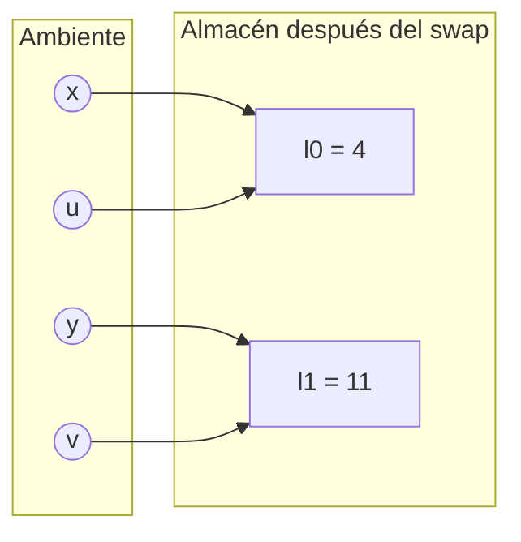
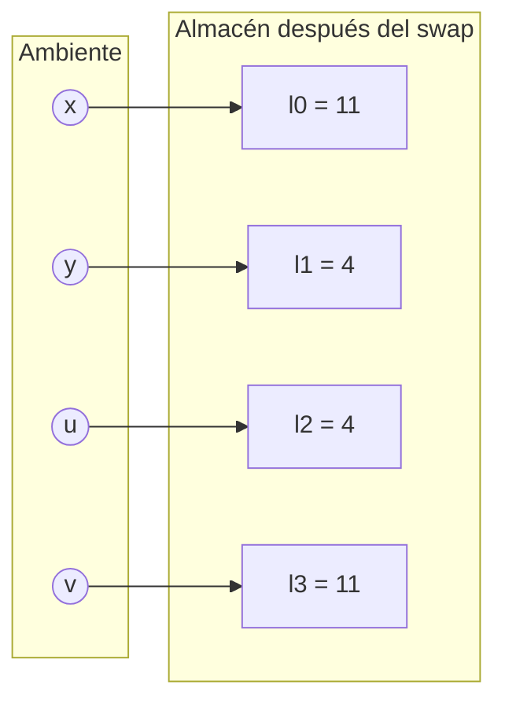

# Informe de corrección — Taller 3

**Curso:** Fundamentos de Interpretación y Compilación de Lenguajes
de Programación — Universidad del Valle, Sede Tuluá.

**Integrantes del grupo:**

| Nombre completo | Código | Correo institucional |
|---|---|---|
| Adriana Milena Noscue Dagua | 2477336 | adriana.noscue@correounivalle.edu.co |
| Sebastian Cucalon Astorquiza | 2477344 | sebastian.cucalon@correounivalle.edu.co |
| Santiago Torres Rojas | 2380301 | santiago.torres.rojas@correounivalle.edu.co |
| Nicolle Camila Hoyos Puin | 2380608 | nicolle.hoyos@correounivalle.edu.co |	

---

Informe 


## Parte 2: paso por valor y paso por referencia

### 1. Los dos mecanismos

En Cauca con referencias, una referencia $\ell$ es un valor de primera clase: se puede ligar a un identificador, guardar en una celda y pasar a un procedimiento. Por eso la diferencia entre `apply` y `applyref` no está en *qué* se pasa, sino en *qué se hace con lo que se pasa*.

- **`apply` (por valor).** Evalúa cada argumento y liga el parámetro a una **copia** del valor resultante.
- **`applyref` (por referencia).** Sus argumentos son identificadores ya ligados a referencias, y cada parámetro queda ligado a **la misma referencia**, sin copiar nada.

La función de copia que usa `apply` (`copia-por-valor` en `src/interprete.rkt`) se define así:

$$
\mathrm{copia}(v) =
\begin{cases}
v & \text{si } v \text{ no es una referencia (número, booleano, procedimiento)} \\
\mathrm{newref!}(\mathrm{deref}(\ell)) & \text{si } v = \ell \text{ es una referencia}
\end{cases}
$$

Para un número, un booleano o un procedimiento, la copia es el mismo valor y no hay nada observable. Para una referencia, copiar es reservar una celda nueva con el mismo contenido: el procedimiento recibe **su propia celda** y lo que escriba adentro no se ve afuera. Esa regla es la que separa los dos mecanismos. Sin ella serían indistinguibles, porque pasar una referencia por valor compartiría la celda igual.

**`let` no copia.** La ligadura `let otro = celda` liga `otro` a la misma referencia que `celda`, de modo que los dos nombres son alias de una sola celda. La diferencia entre ligar con `let` y pasar con `apply` es deliberada: `let` comparte la celda, `apply` entrega una copia.

### 2. Semántica de `app-ref-exp`

1. Evalúa el operador y verifica con `procval?` que sea un procedimiento; si no, levanta `eopl:error`.
2. Busca cada identificador en el ambiente y verifica con `referencia?` que su valor sea una referencia; si alguno no lo es, levanta `eopl:error` indicando que el paso por referencia exige variables ligadas a referencias.
3. Verifica que la cantidad de argumentos coincida con la de parámetros; si no, levanta `eopl:error`.
4. Evalúa el cuerpo en el ambiente de la clausura extendido con los parámetros ligados a **esas mismas referencias** (sin pasar por `copia-por-valor`).

### 3. El programa que separa los dos mecanismos

```
let x = newref(11)
    y = newref(4)
in
  let intercambiar = proc (u : refto(num), v : refto(num))
                       swap(u, v)
                     end
  in
    begin
      applyref intercambiar (x, y);
      -(deref(x), deref(y))
    end
  end
end
```

**Resultado: $-7$.**

Tras `newref(11)` y `newref(4)`, el almacén es

$$\sigma_0 = [\,0 \mapsto 11,\ 1 \mapsto 4\,]$$

con `x` ligada a $\ell_0$ y `y` ligada a $\ell_1$. Con `applyref`, `u` queda ligada a $\ell_0$ y `v` a $\ell_1$: son las mismas celdas. El `swap(u, v)` intercambia sus contenidos:

$$\sigma_1 = [\,0 \mapsto 4,\ 1 \mapsto 11\,]$$

Al volver, `deref(x)` $= 4$ y `deref(y)` $= 11$, así que `-(deref(x), deref(y))` $= 4 - 11 = -7$.



#### La misma expresión con `apply`

```
let x = newref(11)
    y = newref(4)
in
  let intercambiar = proc (u : refto(num), v : refto(num))
                       swap(u, v)
                     end
  in
    begin
      apply intercambiar (x, y);
      -(deref(x), deref(y))
    end
  end
end
```

**Resultado: $7$.**

Con `apply`, antes de entrar al cuerpo se copian los argumentos: `copia-por-valor` reserva $\ell_2$ con el contenido de $\ell_0$ y $\ell_3$ con el de $\ell_1$:

$$\sigma_1 = [\,0 \mapsto 11,\ 1 \mapsto 4,\ 2 \mapsto 11,\ 3 \mapsto 4\,]$$

`u` queda ligada a $\ell_2$ y `v` a $\ell_3$. El `swap(u, v)` actúa solo sobre las copias:

$$\sigma_2 = [\,0 \mapsto 11,\ 1 \mapsto 4,\ 2 \mapsto 4,\ 3 \mapsto 11\,]$$

Las celdas de `x` y `y` ($\ell_0$ y $\ell_1$) no cambiaron, así que `-(deref(x), deref(y))` $= 11 - 4 = 7$.



| Mecanismo | Celdas que ve `u`, `v` | `deref(x)` | `deref(y)` | Resultado |
|---|---|---|---|---|
| `applyref` | $\ell_0$, $\ell_1$ (las mismas) | 4 | 11 | $-7$ |
| `apply` | $\ell_2$, $\ell_3$ (copias) | 11 | 4 | $7$ |

### 4. Ejemplos adicionales de paso por referencia

**Ejemplo A: un contador que se incrementa desde un procedimiento.**

```
let c = newref(0)
    inc = proc (r : refto(num)) setref(r, add1(deref(r))) end
in begin applyref inc (c); applyref inc (c); deref(c) end end
```

Resultado: $2$. Cada `applyref` escribe en la celda de `c`. Con `apply` en lugar de `applyref` el resultado es $0$, porque `inc` incrementa una copia y la celda de `c` no cambia.

**Ejemplo B: dos celdas, una se modifica con el contenido de la otra.**

```
let a = newref(3)
    b = newref(4)
    sumar = proc (x : refto(num), y : refto(num))
              setref(x, +(deref(x), deref(y)))
            end
in begin applyref sumar (a, b); deref(a) end end
```

Resultado: $7$. `sumar` escribe $3 + 4$ en la celda de `a`, y el cambio se ve afuera.

**Ejemplo C: un alias y `applyref` juntos.**

```
let c = newref(0)
    inc = proc (r : refto(num)) setref(r, add1(deref(r))) end
in
  let d = c
  in begin applyref inc (d); deref(c) end
  end
end
```

Resultado: $1$. `d` es un alias de `c` (`let` no copia), así que pasar `d` por referencia modifica la celda que también ve `c`.

### 5. Casos de error

**Error 1: el argumento no está ligado a una referencia.**

```
let f = proc (r : refto(num)) deref(r) end
in applyref f (n) end
```

`n` está ligado al número $10$ en el ambiente inicial, no a una referencia. El intérprete levanta `eopl:error` con el mensaje de que el paso por referencia exige variables ligadas a referencias.

**Error 2: aridad incorrecta.**

```
let c = newref(1)
    f = proc (r : refto(num)) deref(r) end
in applyref f (c, c) end
```

El procedimiento espera un argumento y recibe dos. El intérprete levanta `eopl:error` indicando cuántos argumentos esperaba y cuántos recibió.

**Error adicional: el operador no es un procedimiento.**

```
let c = newref(1) in applyref c (c) end
```

`c` es una referencia, no un procedimiento, así que `app-ref-exp` levanta `eopl:error` antes de buscar los argumentos.

---


## 1. Marco formal

### 1.1 Corrección de programas recursivos

Sea $f : A \to B$ una función y $A$ un conjunto definido
recursivamente. Sea $P_f$ un programa recursivo en Racket que
pretende calcular $f$. Decimos que $P_f$ es correcto con respecto a
su especificación si se cumple:

$$
\forall a \in A \,:\, P_f(a) = f(a)
$$

La estrategia de demostración es la **inducción estructural**
sobre $A$:

- **Caso base:** para cada valor básico $a_0 \in A$ se verifica
  $P_f(a_0) = f(a_0)$.
- **Caso inductivo:** asumiendo la **hipótesis de inducción**
  $P_f(a') = f(a')$ para las subestructuras $a'$ que forman $a$, se
  demuestra $P_f(a) = f(a)$.

### 1.2 Corrección de programas iterativos

Para un programa iterativo se formalizan:

- Un estado $s$ con componentes relevantes.
- Un estado inicial $s_0$.
- Un estado final reconocido por un predicado $\text{es-final?}(s)$.
- Una **invariante** $\text{Inv}(s)$ que se mantiene entre pasos.
- Una transformación $\text{transformar}(s)$.

La corrección se argumenta demostrando:

1. $\text{Inv}(s_0)$ se cumple al inicio.
2. $\text{Inv}(s) \,\land\, \lnot\text{es-final?}(s)\Rightarrow
   \text{Inv}(\text{transformar}(s))$.
3. $\text{Inv}(s) \,\land\, \text{es-final?}(s)\Rightarrow
   \text{respuesta}(s) = f(\text{entrada})$.
4. El proceso termina (argumentar una función de cota estrictamente
   decreciente sobre $\mathbb{N}$).

---

## 2. Funciones analizadas

> Complete **una subsección por cada función pedida en el enunciado**.
> Copie la plantilla de subsección tantas veces como sea necesario.

### 2.1 Corrección de `{{nombre-funcion-1}}`

**Especificación.**

- **Tipo:** `{{nombre-funcion-1}} : {{Tipo de entrada}} -> {{Tipo de salida}}`
- **Pre-condición:** $\text{Pre}(a) \equiv \{{\ldots}\}$.
- **Post-condición:** $\text{Post}(a, r) \equiv r = f(a)$, donde
  $f$ es {{descripción matemática de la función}}.

**Código.**

```racket
; {{nombre-funcion-1}} : {{contrato}}
; Propósito: {{...}}
(define ({{nombre-funcion-1}} ...)
  ...)
```

**Estrategia de demostración:** {{recursión estructural sobre ... /
iteración con invariante ...}}.

**Demostración.**

- **Caso base** ($a = {{\ldots}}$):

  $$
  P_f({{\ldots}}) \to {{\ldots}} \quad \land \quad f({{\ldots}}) = {{\ldots}}
  $$

  Por lo tanto $P_f({{\ldots}}) = f({{\ldots}})$.

- **Caso inductivo** ($a = {{\ldots}}$): asumimos la hipótesis de
  inducción $P_f(a') = f(a')$ para {{las subestructuras de $a$}}.

  $$
  P_f(a) \to {{\ldots (aplicar una evaluación) \ldots}}
  $$

  Usando la hipótesis de inducción:

  $$
  \quad = {{\ldots}} = f(a).
  $$

- **Terminación.** {{Identifique la medida que decrece estrictamente
  en cada llamada recursiva — por ejemplo, la longitud de la lista o
  el tamaño del AST — y argumente que está acotada inferiormente.}}

**Conclusión:** $\forall a \in A \,:\, P_f(a) = f(a)$, por lo tanto
`{{nombre-funcion-1}}` es correcta respecto a su especificación.

---

### 2.2 Corrección de `{{nombre-funcion-2}}`

**Especificación.**

- **Tipo:** `{{...}}`
- **Pre-condición:** $\{{\ldots}\}$.
- **Post-condición:** $\{{\ldots}\}$.

**Código.**

```racket
(define ({{nombre-funcion-2}} ...)
  ...)
```

**Demostración.** {{Siga el mismo esquema: casos base, caso
inductivo con hipótesis de inducción y terminación. Para casos de
error explícitos —por ejemplo `eopl:error` cuando una condición no
es booleana— demuestre que el programa levanta el error en ese caso y
sólo en ese caso.}}

---

### 2.3 Corrección de `{{nombre-funcion-3}}`

{{Repetir la misma estructura.}}

---

## 3. Propiedades adicionales (si aplica)

Incluya en esta sección cualquier propiedad adicional que el
enunciado exija demostrar, por ejemplo:

- **Shadowing de ambientes** (`apply-env`): la ligadura más reciente
  tiene prioridad sobre las anteriores.
- **Secuencialidad de `let*`**: cada ligadura se evalúa en un
  ambiente que incluye las anteriores.
- **Equivalencia semántica** entre dos implementaciones (por ejemplo,
  representación basada en listas vs. basada en procedimientos de un
  mismo TAD).
- **Invariante del almacén**: si $\sigma' = \text{setref!}(\sigma, \ell, v)$,
  entonces $\sigma'(\ell) = v$ y $\sigma'(\ell') = \sigma(\ell')$ para todo
  $\ell' \neq \ell$. La operación que reserva una celda es la única que
  cambia la longitud del almacén.
- **Invariante de la transacción**: sea $\sigma_0$ el almacén al entrar a
  un bloque `atomic` y $\sigma$ el almacén en el momento de abortar. Si
  el registro de la transacción guarda, para cada celda $\ell$ escrita
  dentro del bloque, el valor $\sigma_0(\ell)$ que tenía al entrar, y la
  longitud $|\sigma_0|$, entonces revertir devuelve exactamente
  $\sigma_0$: las celdas registradas recuperan su valor, las que no se
  escribieron nunca cambiaron, y las creadas adentro (posiciones
  $\geq |\sigma_0|$) desaparecen. Demostrar por inducción sobre el
  número de escrituras del bloque, y tratar aparte el caso de una
  transacción hija que confirmó antes de que la padre abortara.
- **Paso por referencia**: el parámetro queda ligado a la misma
  referencia del argumento, de modo que una escritura dentro del
  procedimiento se observa fuera. Contrastar con el paso por valor
  sobre el mismo programa.
- **Solidez de un chequeador de tipos**: si $\Gamma \vdash e : t$ y el
  ambiente de valores $\rho$ concuerda con el ambiente de tipos
  $\Gamma$, entonces $\text{value-of}(e, \rho)$ es un valor de tipo
  $t$. Precisar primero qué significa la concordancia entre $\rho$ y
  $\Gamma$.

Cada propiedad debe enunciarse formalmente y demostrarse con el
mismo rigor que las funciones anteriores.

---

## 4. Referencias

- Friedman, D. P., & Wand, M. *Essentials of Programming Languages*,
  3.ª ed., MIT Press, 2008. Secciones {{…}}.
- {{Otras referencias que hayan consultado.}}
